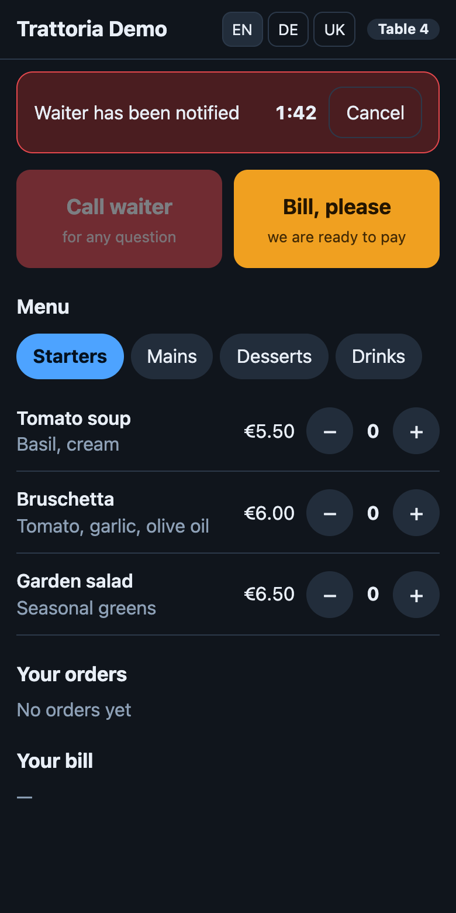
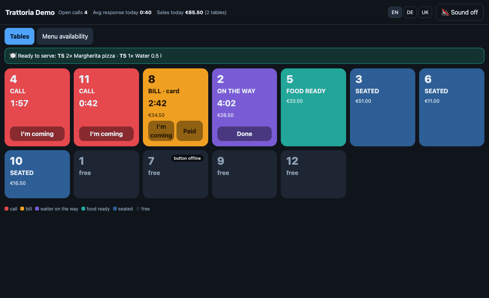
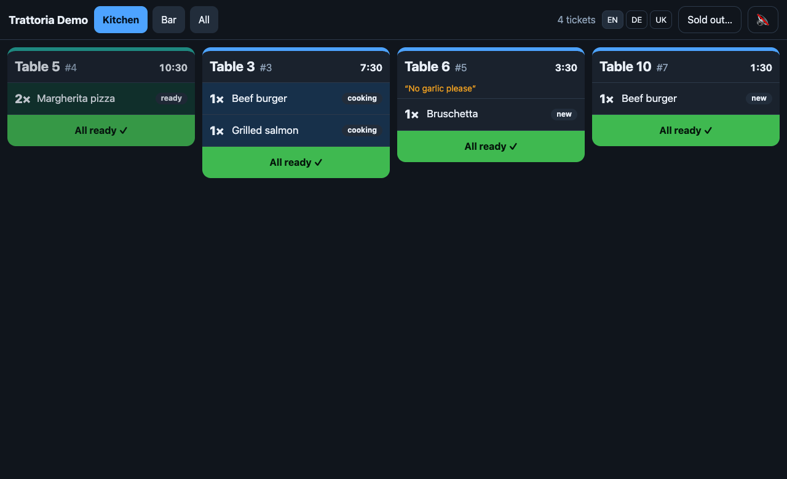

# Tablebell

<table><tr><td valign="top">

Offline table service for restaurants and cafés. Every table has a small ESP module with one button.
Guests press it to call a waiter (short press) or ask for the bill (hold), and can also scan a QR code
to see their bill and order food and drinks from their phone. Waiters get a live dashboard, the
kitchen and the bar get their own ticket screens. **No internet is needed**: everything runs on the
restaurant's own Wi-Fi.

</td><td width="260" valign="top"></td></tr></table>

| Waiter dashboard | Kitchen |
|---|---|
|  |  |

More: [ordering](docs/screenshots/guest-menu.png), [cart](docs/screenshots/guest-cart.png), [bill](docs/screenshots/guest-bill.png),
[German UI](docs/screenshots/guest-de.png), [table detail](docs/screenshots/waiter-table.png), [bar view](docs/screenshots/bar.png).
(Screenshots are generated from the demo data by `npm run screenshots`.)

## Architecture

```
 [table node]──┐                       ┌── waiter phones/tablets  /waiter
 [table node]──┤  Wi-Fi (HTTP POST)    │── kitchen screen         /kitchen
 [table node]──┼──────►  HUB  ◄────────┤── bar screen             /bar
 ...           │   Raspberry Pi/laptop │── guest phones           /?t=7&k=…  (QR on the table)
               │   Node.js + Wi-Fi AP  │
```

**Decision: one central hub (Raspberry Pi or any laptop/mini-PC) plus cheap ESP8266/ESP32 button nodes.**

Why not ESP-NOW or one access point per table:

* A restaurant needs a database-like state (orders, bills, statuses) shared by waiters, kitchen and guests. That is trivial and
  durable on a Pi (file/SQLite-class storage, real clock, hundreds of MB) and painful on a microcontroller's flash.
* A per-table access point would force waiters to hop between networks and makes the kitchen view impossible.
* The hub is also the Wi-Fi access point and a wildcard DNS ("captive portal"), so guests need nothing installed.
* Table nodes only ever send small HTTP POSTs, so the firmware stays tiny and dependency-free (ESP-01 compatible).
  A node does not need to be a Wi-Fi access point and can be replaced in two minutes: flash it, set `TABLE_ID`, done.
* ESP-NOW would give battery-friendly nodes but needs an ESP32/ESP8266 acting as gateway next to the hub, an
  extra moving part. This project trades battery life for simplicity: nodes are meant to be **USB-powered** (a phone charger
  or a USB cable to a power strip). If you need battery nodes, the HTTP protocol below is small enough to add a deep-sleep variant.

The hub is the only part that must be reliable, and it is plain Node.js with **no npm dependencies**; state is saved atomically to
`hub/data/state.json`, so a power cut loses nothing.

### How calls are never lost

1. The node queues each event (call/bill/cancel) with a unique id and retries with back-off (1 s … 15 s) until the hub acknowledges it.
2. The hub is idempotent: a retried id is recognised, and even a re-sent "call" for a table that already has one is a no-op.
3. The hub persists to disk before answering. After a restart, pending calls are still there, and the node's next heartbeat shows them on its LED.
4. The dashboard flags nodes that stopped sending heartbeats ("button offline"), so a dead button does not go unnoticed.
5. Table identity is configured on the node (`TABLE_ID`) and shown on every card; guests are bound to a table by the secret key in their QR code.

## Features

* **Table button**: short press = call waiter, hold 1.5 s = bill please, hold 5 s = cancel an unanswered request. Debounced, rate limited.
  LED feedback: solid on press, fast blink = call pending, double pulse = bill pending, solid = "waiter is coming", two blinks = hub unreachable. Optional buzzer.
* **Waiter dashboard** (`/waiter`): table cards coloured by status (call, bill, waiter on the way, food ready, seated, free), running wait timers,
  one-tap "I'm coming" / "Done" / "Paid", "ready to serve" strip, per-table orders, waiters can add items themselves, flag a table manually,
  mark items sold out, see button signal strength, average response time and sales of the day. Optional sound alert.
* **Guest page** (`/?t=7&k=…`, English/German/Ukrainian): call waiter, bill please, browse menu, order (with note), live order status
  (received, being prepared, ready, served), running bill, choose cash/card (payment-request flag for the waiter). Guests can cancel an order until the kitchen starts it.
* **Kitchen and bar views** (`/kitchen`, `/bar`): tickets with timers (turn amber/red when late), tap an item to advance it new → cooking → ready; drinks and food are routed by station. A "Sold out…" button lets the kitchen or bar mark items unavailable on the spot (also in the dashboard's Menu tab); guests see them greyed out within seconds.
* **Safeguards**: PIN for staff pages with login throttling, shared secret for nodes, per-table key for guests, server-side prices, rate limits.
  Optional `confirmOrders` makes every guest order wait for a waiter's confirmation (recommended if pranks are a concern).

## Hardware

Per table: an ESP-01/ESP-01S, ESP8266 (NodeMCU/D1 mini) or ESP32 board, a momentary push button (large arcade button looks nice),
an LED with 330 Ω resistor (many dev boards have one already) and, optionally, an active buzzer. USB power.

| Board (`-e`) | Button (to GND) | LED | Buzzer |
|---|---|---|---|
| `esp01_1m` | GPIO0 | GPIO2 (LED between 3V3 and GPIO2 via 330 Ω: lit when low) | none (no free pin) |
| `nodemcuv2` | D2 / GPIO4 | on-board GPIO2 (active low) | D5 / GPIO14 |
| `esp32dev` | GPIO4 | on-board GPIO2 | GPIO27 |
| `esp32c3` | GPIO3 | on-board GPIO8 (active low) | GPIO4 |

* The button connects the pin to **GND**; the internal pull-up is used. ESP-01: do not hold the button while powering up (GPIO0 low = flash mode).
* ESP-01 needs a stable 3.3 V supply (≥ 300 mA). Use a proper adapter board, not the 3.3 V pin of a flaky USB-serial dongle.
* Active buzzer + to the buzzer pin, – to GND (use a small transistor if the buzzer draws more than ~10 mA).
* Pins can be changed in `platformio.ini` (`-DBUTTON_PIN=…`).

## Setup

### 1. Hub (Raspberry Pi 3/4/5 or Pi Zero 2 W with Raspberry Pi OS Bookworm; any Linux/macOS machine also works for testing)

```bash
sudo apt install -y nodejs        # Node 18 or newer
git clone <this repo> tablebell && cd tablebell
cp hub/config.example.json hub/config.json   # then edit: tables, staffPin, nodeKey, currency, restaurantName
nano hub/menu.json                           # your menu (id, category, price, station kitchen|bar)
sudo sh deploy/setup-ap.sh "Tablebell" "a-long-wifi-password"   # Pi becomes access point 192.168.50.1 + captive DNS
sudo cp deploy/tablebell.service /etc/systemd/system/ && sudo systemctl enable --now tablebell
```

Without a Pi: `node hub/server.js --port 8080` on any computer on the same network and set `HUB_HOST`/`HUB_PORT` in the node firmware to its address
(give it a fixed IP/DHCP reservation). `npm run demo` serves realistic demo data on port 8080 for a look around.

Configuration keys (`hub/config.json`): `restaurantName`, `port`, `tables`, `currency`, `staffPin` (empty = no PIN, warns), `nodeKey`,
`requireTableKey`, `confirmOrders`, `nodeOfflineSec`, `portalUrl`. The menu file is read at startup; restart the hub after editing it
(sold-out toggles on the dashboard take effect immediately and are saved).

Use two SSIDs if you want the nodes on a separate network from guests (the PIN and key checks stay in force either way).

### 2. Table cards (QR codes)

```bash
node tools/table-sheet/make_sheet.js --host 192.168.50.1 --ssid Tablebell --password a-long-wifi-password --out out
```

Prints `out/tables.pdf` with one card per table: a Wi-Fi QR and a "your table" QR that contains the table number and its secret key.
Cut, laminate, stand on the table. Re-run it whenever you change the number of tables; keys stay stable as long as `hub/data/state.json` is kept.

### 3. Flash the table nodes

Install [PlatformIO](https://platformio.org/), then per node:

```bash
cp firmware/table_node/config.local.h.example firmware/table_node/config.local.h
# edit: TABLE_ID, WIFI_SSID, WIFI_PASS, HUB_HOST, NODE_KEY (same as hub/config.json)
pio run -e esp01_1m -t upload        # or nodemcuv2, esp32dev, esp32c3
pio device monitor                   # optional: serial log at 115200
```

No command line handy? [BugZapper](https://github.com/gumslone/bugzapper) is a small GUI/CLI flasher with a built-in serial monitor for ESP8266/ESP32: build with `pio run -e <env>`, then flash `.pio/build/<env>/firmware.bin` and watch the boot log in one window.

Only `TABLE_ID` changes between nodes. Label each node with its number. ESP-01 flashing needs a USB-serial adapter with GPIO0 pulled to GND while powering up.

### 4. Test

Walk through [docs/TESTING.md](docs/TESTING.md) with the real hardware.

## Development

```bash
npm test                                   # hub API tests (node --test)
g++ -std=c++17 -Wall -Wextra -Werror -Ifirmware/table_node tests/native/test_button.cpp -o /tmp/tc && /tmp/tc   # gesture/queue tests
pio run                                    # build all-env default (esp01_1m); use -e for the others
npm run demo                               # demo data on http://localhost:8080
npm run screenshots                        # regenerate docs/screenshots (needs Google Chrome)
```

CI (`.github/workflows/ci.yml`) builds all four firmware targets, runs the native and hub tests and syntax-checks the web UIs.

## Node ↔ hub protocol

All node requests carry `X-Key: <nodeKey>`.

| Request | Body | Reply |
|---|---|---|
| `POST /api/node/event` | `{"t":7,"ev":"call"\|"bill"\|"cancel","id":123,"rssi":-58,"fw":"1.0"}` | `{"ok":1,"dup":0,"st":"idle\|call\|bill\|ack"}` |
| `POST /api/node/hb` (every 4 s) | `{"t":7,"rssi":-58,"fw":"1.0"}` | `{"ok":1,"st":"…"}` |

`st` is what the LED should show. Guest endpoints take `t` and `k` (table and key), staff endpoints the `X-Token` from `POST /api/staff/login`.

## Limits and honest notes

* One Raspberry Pi is a single point of failure. Keep a spare SD card image; the state file is the only thing to back up.
* Orders and totals are internal bookkeeping for service, not a certified till or fiscal receipt system. Check local regulations before using it as one.
* The Wi-Fi password is printed on the table cards; that is a deliberate trade-off for convenience. Staff pages are protected by the PIN, not by the network.
* Nodes keep queued events in RAM: a call pressed while the hub is down survives Wi-Fi/hub outages but not a power cut of the node itself.

## License

MIT
